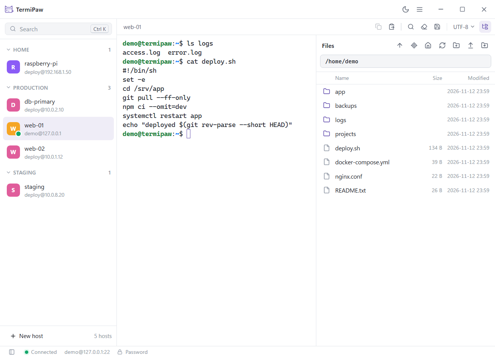

# TermiPaw

A small, fast, portable SSH and SFTP client for Windows.

TermiPaw is a single `.exe` of about 7 MB. There is no installer and no account: put it in a folder, run it, and everything it stores stays in a `TermiPaw_Data` folder next to it. Copy the folder to another computer or a USB drive and your hosts come with you.



[Download](https://github.com/carsonxzhang/TermiPaw/releases/latest) · [Changelog](CHANGELOG.md) · [Roadmap](docs/ROADMAP.md) · [Security](SECURITY.md) · [中文说明](README.zh-CN.md)

## Why TermiPaw

- **Portable.** One file, no installer. TermiPaw does not write to the registry, `%APPDATA%`, `%LOCALAPPDATA%`, environment variables or the Windows Credential Manager. To uninstall, delete the folder. The only exception is the WebView2 runtime that Windows provides, which updates a few registry values of its own ([measured results](docs/PORTABLE.md)).
- **Secure by default.** Host keys are verified on every connection. Passwords are never stored in plain text: they can only be saved in an encrypted vault protected by a master password. Updates are signed with an offline key, so a compromised GitHub account cannot ship a malicious build.
- **Focused.** A terminal, a file panel, and the connection between them. No cloud sync, no telemetry, no plugins.

## Features

**Connections**
- Password, private key (including encrypted keys) and SSH Agent authentication (Windows OpenSSH Agent and Pageant)
- Host list with groups, search and a command palette (`Ctrl+K`); quick connect with `user@host:port`
- Several sessions per host, automatic reconnection after network drops
- Host key verification against TermiPaw's own records and your `~/.ssh/known_hosts` (read only), with a clear warning when a key changes

**Terminal**
- xterm.js with WebGL rendering and true color
- Copy, paste, find in output, clear, and save the current output as a text file
- Confirmation before pasting multiple lines; links open only with `Ctrl`+click and only for http and https
- Character encodings for older servers: UTF-8, GB18030 / GBK, Big5, Shift_JIS, EUC-JP, EUC-KR and Windows-1252, per host or per session

**Files**
- SFTP panel with upload and download of files and folders, drag and drop from Explorer, and a transfer queue
- Uploads go to a temporary file and replace the target only when complete, so an interrupted transfer never leaves a half-written file
- Open a remote file in a local program; saved changes are uploaded automatically, with a prompt if the file also changed on the server
- The file panel can follow the terminal's current directory (bash and zsh)

**Security**
- Master password vault: Argon2id key derivation and XChaCha20-Poly1305 encryption, optional recovery key, optional encryption of the host list itself. Locks after a period of inactivity, whenever Windows locks, and before the computer sleeps ([design](docs/VAULT.md))
- Remote file names, terminal output and server responses are treated as untrusted: path traversal, disguised executables and control characters are blocked
- SHA-1 `ssh-rsa` is not supported

**Everything else**
- Light and dark themes that follow Windows
- English, 简体中文, 繁體中文, 日本語, 한국어, Français, Español and Deutsch
- Built-in updates: TermiPaw tells you when a new version is available and installs it only when you choose to ([how updates are verified](docs/UPDATER.md))

## Getting started

**Requirements:** Windows 10 or 11 (x64) and the Microsoft Edge WebView2 runtime, which is included in Windows 11 and most Windows 10 installations.

1. Download `TermiPaw.exe` from the [releases page](https://github.com/carsonxzhang/TermiPaw/releases/latest). The file name is the same for every version, so shortcuts keep working after you update.
2. Put it in a folder you can write to, such as your desktop, a folder on drive D, or a USB drive. Do not use `C:\Program Files`.
3. Run it. The executable is not code-signed yet, so Windows SmartScreen may show a warning the first time.

Each release lists the SHA-256 checksum of the executable.

### Where your data is stored

Everything is in the `TermiPaw_Data` folder next to the executable:

| File or folder | Contents |
| --- | --- |
| `hosts.json` | Saved hosts (no passwords) |
| `known_hosts.json` | Trusted host keys |
| `vault.json` | The encrypted vault, if turned on |
| `webview\` | Interface settings such as language and theme |
| `editing\` | Temporary copies of remote files open in local programs |
| `logs\` | Terminal output you save, unless you choose another place |

When the vault encrypts host information, `hosts.json` and `known_hosts.json` are moved into `vault.json`.

## Keyboard shortcuts

| Shortcut | Action |
| --- | --- |
| `Ctrl+K` / `Ctrl+T` | Command palette |
| `Ctrl+N` | New host |
| `Ctrl+W` | Close session |
| `Ctrl+Tab` / `Ctrl+Shift+Tab` | Next / previous session |
| `Ctrl+Shift+E` | File panel |
| `Ctrl+B` | Sidebar |
| `Ctrl+Shift+C` / `Ctrl+Shift+V` | Copy / paste |
| `Ctrl+Shift+F` | Find in terminal output |

## Current limitations

- Windows x64 only.
- Keyboard-interactive authentication is not supported yet, so servers that require one-time codes or allow only keyboard-interactive login cannot be used. It is planned for 0.8.
- No port forwarding yet (planned for 0.9) and no jump hosts.
- File names in the file panel must be UTF-8. The terminal encoding setting does not apply to them.
- Following the terminal directory works with bash and zsh only.

## Building from source

You need Windows, Node.js 22, Rust (stable), the Visual Studio C++ build tools and WebView2.

```bash
npm install
npm run app          # run in development mode
npm run app:build    # build builds/TermiPaw_<version>_x64.exe
```

See [CONTRIBUTING.md](CONTRIBUTING.md) for the development server, tests and project layout.

## Contributing

Bug reports and suggestions are welcome in [Issues](https://github.com/carsonxzhang/TermiPaw/issues). Translations other than English and Simplified Chinese were produced with AI assistance and have not been reviewed by native speakers, so corrections are especially welcome; see [docs/I18N.md](docs/I18N.md).

Please report security problems privately as described in [SECURITY.md](SECURITY.md), not in a public issue.

## License

Licensed under either of [MIT](LICENSE-MIT) or [Apache-2.0](LICENSE-APACHE), at your option.
