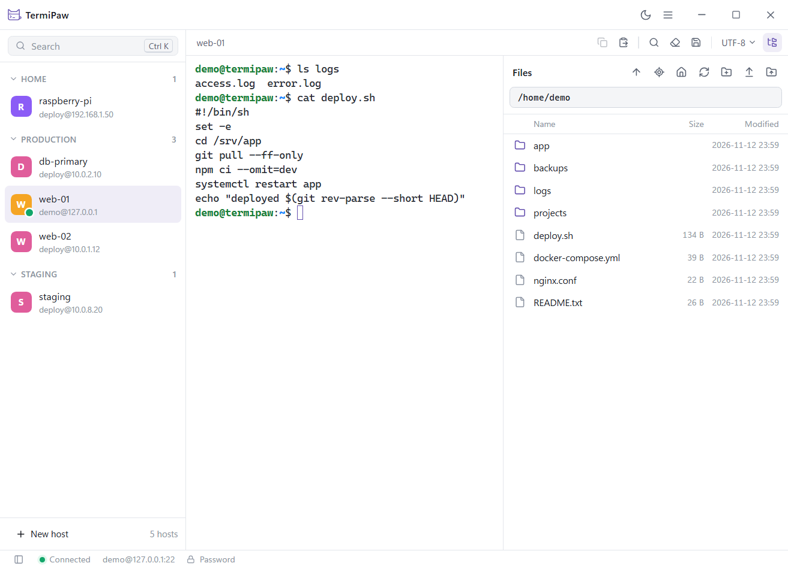

# TermiPaw

小巧、快速、免安装的 Windows SSH / SFTP 客户端。

TermiPaw 只有一个约 7 MB 的 `.exe`，不需要安装，也不需要注册账号。放进任意文件夹即可运行，所有数据都保存在它旁边的 `TermiPaw_Data` 文件夹里。把整个文件夹复制到另一台电脑或 U 盘，主机配置也随之带走。



[下载](https://github.com/carsonxzhang/TermiPaw/releases/latest) · [更新记录](CHANGELOG.md) · [路线图](docs/ROADMAP.md) · [安全](SECURITY.md) · [English](README.md)

## 特点

- **免安装。** 只有一个文件，没有安装程序。TermiPaw 不写注册表、`%APPDATA%`、`%LOCALAPPDATA%`、环境变量和 Windows 凭据管理器。卸载时删除文件夹即可。唯一的例外是 Windows 提供的 WebView2 运行时，它在运行时会改写几个自己的注册表值（[实测结果](docs/PORTABLE.md)）。
- **默认安全。** 每次连接都校验主机指纹。密码从不以明文保存，只能保存在由主密码加密的保险库中。更新使用离线密钥签名，即使 GitHub 账号被盗，也无法发布恶意版本。
- **专注。** 终端、文件面板，以及两者之间的联动。没有云同步，不收集任何使用数据，也没有插件。

## 功能

**连接**
- 密码、私钥（含加密私钥）和 SSH Agent 认证（Windows OpenSSH Agent、Pageant）
- 主机分组、搜索和命令面板（`Ctrl+K`）；输入 `user@host:port` 快速连接
- 同一主机可开多个会话，网络中断后自动重连
- 依据 TermiPaw 自己的记录和 `~/.ssh/known_hosts`（只读）校验主机指纹，指纹变化时醒目警告

**终端**
- 基于 xterm.js，WebGL 渲染，支持真彩色
- 复制、粘贴、在输出中查找、清屏，以及把当前输出保存为文本文件
- 粘贴多行内容前先确认；按住 `Ctrl` 点击才打开链接，且只打开 http 和 https 链接
- 支持较老服务器使用的字符编码：UTF-8、GB18030 / GBK、Big5、Shift_JIS、EUC-JP、EUC-KR 和 Windows-1252，可按主机保存，也可在会话中临时切换

**文件**
- SFTP 面板：上传和下载文件及文件夹，支持从资源管理器拖入，带传输队列
- 上传先写入临时文件，完成后才替换目标文件，传输中断不会留下写了一半的文件
- 用本地程序打开远程文件，保存后自动传回；服务器上的文件也被修改过时会先询问
- 文件面板可以跟随终端的当前目录（bash 和 zsh）

**安全**
- 主密码保险库：Argon2id 密钥派生、XChaCha20-Poly1305 加密，可选恢复密钥，也可加密主机列表本身。空闲一段时间、Windows 锁屏和电脑睡眠前都会自动锁定（[设计说明](docs/VAULT.md)，英文）
- 远程文件名、终端输出和服务器响应一律视为不可信：路径穿越、伪装的可执行文件和控制字符都会被拦截
- 不支持 SHA-1 的 `ssh-rsa`

**其他**
- 浅色和深色主题，可跟随 Windows 设置
- English、简体中文、繁體中文、日本語、한국어、Français、Español、Deutsch
- 内置更新：有新版本时提示，由你决定何时安装（[更新的校验方式](docs/UPDATER.md)，英文）

## 开始使用

**系统要求：** Windows 10 或 11（x64），以及 Microsoft Edge WebView2 运行时。Windows 11 自带，大部分 Windows 10 也已安装。

1. 从[发布页面](https://github.com/carsonxzhang/TermiPaw/releases/latest)下载 `TermiPaw.exe`。每个版本的文件名都一样，更新后快捷方式依然有效。
2. 放进一个可以写入的文件夹，例如桌面、D 盘上的文件夹或 U 盘。不要放在 `C:\Program Files`。
3. 双击运行。程序目前还没有代码签名，第一次运行时 Windows SmartScreen 可能会提示警告。

每个版本的发布页面都列出了 exe 的 SHA-256 校验值。

### 数据保存在哪里

所有数据都在程序旁边的 `TermiPaw_Data` 文件夹里：

| 文件或文件夹 | 内容 |
| --- | --- |
| `hosts.json` | 保存的主机（不含密码） |
| `known_hosts.json` | 已信任的主机指纹 |
| `vault.json` | 加密的保险库（开启后才有） |
| `webview\` | 界面设置，例如语言和主题 |
| `editing\` | 用本地程序打开的远程文件的临时副本 |
| `logs\` | 保存的终端输出（保存时也可以另选位置） |

保险库开启“加密主机信息”后，`hosts.json` 和 `known_hosts.json` 会移进 `vault.json`。

## 快捷键

| 快捷键 | 功能 |
| --- | --- |
| `Ctrl+K` / `Ctrl+T` | 命令面板 |
| `Ctrl+N` | 新建主机 |
| `Ctrl+W` | 关闭会话 |
| `Ctrl+Tab` / `Ctrl+Shift+Tab` | 下一个 / 上一个会话 |
| `Ctrl+Shift+E` | 文件面板 |
| `Ctrl+B` | 侧栏 |
| `Ctrl+Shift+C` / `Ctrl+Shift+V` | 复制 / 粘贴 |
| `Ctrl+Shift+F` | 在终端输出中查找 |

## 目前的局限

- 只支持 Windows x64。
- 暂不支持键盘交互认证（keyboard-interactive），因此需要输入一次性验证码、或只允许键盘交互登录的服务器暂时无法使用。计划在 0.8 支持。
- 暂不支持端口转发（计划在 0.9），也不支持跳板机。
- 文件面板中的文件名必须是 UTF-8 编码，终端的编码设置对文件名不起作用。
- 跟随终端目录只支持 bash 和 zsh。

## 从源码构建

需要 Windows、Node.js 22、Rust（stable）、Visual Studio C++ 生成工具和 WebView2。

```bash
npm install
npm run app          # 开发模式运行
npm run app:build    # 构建 builds/TermiPaw_<版本>_x64.exe
```

开发服务器、测试和项目结构见 [CONTRIBUTING.md](CONTRIBUTING.md)（英文）。

## 参与贡献

欢迎在 [Issues](https://github.com/carsonxzhang/TermiPaw/issues) 中报告问题或提出建议，中文或英文均可。除英文和简体中文外，其他语言由 AI 辅助翻译，尚未经母语者审校，特别欢迎指正，见 [docs/I18N.md](docs/I18N.md)。

安全问题请按 [SECURITY.md](SECURITY.md) 的说明私下报告，不要公开提交 Issue。

## 许可证

可任选 [MIT](LICENSE-MIT) 或 [Apache-2.0](LICENSE-APACHE) 许可证使用。
